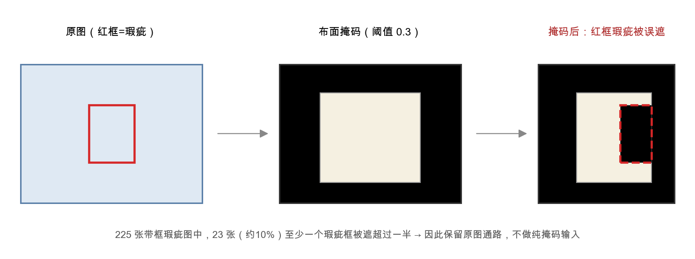
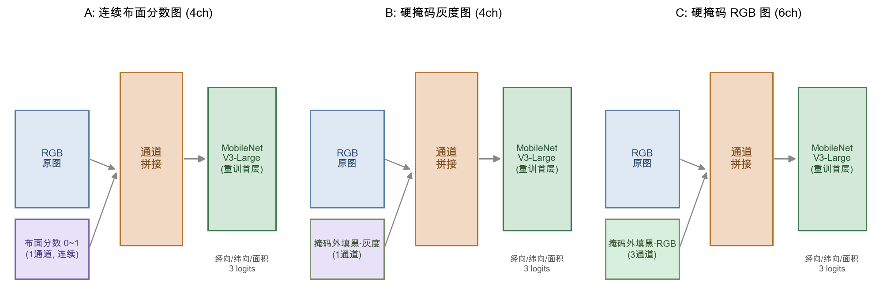
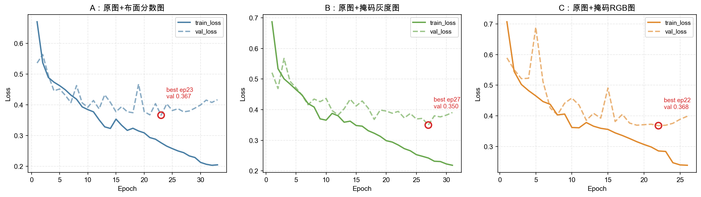
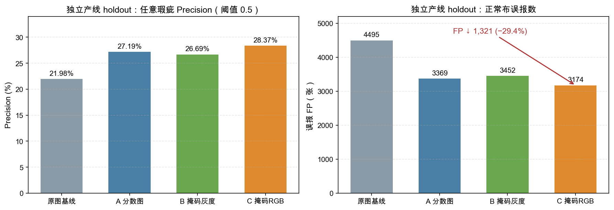

# 布面瑕疵分类：布面掩码信息融合实验

在织机布面瑕疵视觉检测任务上，用 MobileNetV3-Large 做经向 / 纬向 / 面积异常的多标签分类。**核心问题：原图分类器在独立测试集上召回很高（98.75%）但误报严重（Precision 仅 21.98%），大量正常布被判为瑕疵。** 本项目围绕“引入布面分割信息能否抑制误报”做了一轮完整的方法调研、方案设计、对照实验和复盘。

## 1. 背景

- **任务**：布面图像三标签分类，标签为经向异常、纬向异常、面积异常；允许同图共存，输出为各标签的 sigmoid 分数。
- **已有基线**：ImageNet 预训练的 MobileNetV3-Large，输入原图 RGB，BCEWithLogitsLoss 多标签训练。验证集表现正常（mAP 93.39%），但在一条独立产线的 holdout 上出现大量正常布误报。
- **假设的误报来源**：织机现场相机视野里不只有布面，还有辊筒、机器结构、背景等非布面区域，这些区域容易被分类器当成“异常纹理”。
- **现成资源**：项目内已有一个布面/非布面分割模型（EfficientNet-B0 编码器 + U-Net 解码器，ONNX 格式），可输出逐像素布面分数。该模型不是公开预训练模型，而是团队用内部采集图片和人工标注布面区域训练的自研分割模型；本项目把它当黑盒使用，不重训、不修改。详见 [布面分割模型](#7-布面非布面分割模型)。

## 2. 问题定义与风险

直接用分割掩码把“非布面”区域涂黑看似合理，但有两个风险：



1. **误遮布面**：分割不完美时，真实布面区域可能被当背景涂掉，瑕疵证据一并丢失。我在 225 张带标注框的瑕疵图上做过量化检查：**阈值 0.3 的硬掩码会让 23 张图（约 10%）至少一个瑕疵框被遮掉一半以上**。这个风险是真实存在的，不是理论担忧。
2. **信息浪费**：硬掩码把连续的分割置信度变成 0/1，丢掉了“模型自己有多确定”的信息。

所以这个实验真正要回答的问题是：**布面信息应该以什么形式进入分类器，才能在抑制背景误报的同时不误伤布面瑕疵？**

## 3. 方法调研

动手前查了掩码/前景信息融合的已有做法：

| 来源 | 做法 | 对本项目的启示 |
|---|---|---|
| FG-AS（IEEE SPL 2026） | 掩码条件残差进解码器，粗异常图、掩码与前景加权响应联合融合 | 掩码当“提示”用，不当“硬规则”用；前景分割不准时不直接排除掩码外异常 |
| Mask-Adapter（开源代码） | 学习空间权重来吸收掩码不确定性 | 学一个融合权重比人工拼接更有弹性 |
| Mahbod 等的对照实验 | 额外掩码通道 vs 硬去背景 | 硬去背景反而降低分类表现，支持“保留原图”的路线 |
| SHMC-Net | 图像特征和掩码特征融合 | 图 + 掩码双路融合在其任务上提高 F1 |

**结论**：文献一致支持“保留原图通路 + 掩码作为辅助信息”，反对“用掩码直接删除像素”。最初我设计过一个更严谨的版本（冻结原图主干 + 掩码条件残差 + 有上限的分数修正），但考虑到需要可控的对照实验周期，第一轮先验证最直接的形态——**通道拼接后端到端重训**。这是有意识的简化，不是不知道更复杂的做法。

## 4. 实验设计

### 4.1 三种融合形态



| 组 | 输入构造 | 通道数 | 设计动机 |
|---|---|---:|---|
| 基线 | 原图 RGB | 3 | 对照组，不引入掩码 |
| A | RGB + 连续布面分数图 | 4 | 保留分割模型的软输出，不丢置信度信息 |
| B | RGB + 硬掩码灰度图 | 4 | 分数阈值 0.3，掩码外填黑后转灰度；最接近“去背景”的形态 |
| C | RGB + 硬掩码 RGB 图 | 6 | 掩码外填黑但保留 RGB 三通道；比 B 保留更多颜色纹理 |

A/B/C **全部从 ImageNet 预训练权重独立重训**，不从原图基线第 23 轮续训。三组共用同一份训练/验证 split、同一套超参、同一个数据加载顺序，保证唯一变量是辅助输入形态。

### 4.2 关键工程决策

1. **几何对齐**：原图和辅助图使用完全相同的裁剪参数、翻转参数和目标尺寸。每张图只采样一次几何变换，两路共用，避免 RGB 和掩码错位——错位会让融合输入自相矛盾。
2. **预计算分数缓存**：分割模型推理较慢，为全部 39,262 张训练/验证图预计算 512×512 float16 布面分数，分片存储 + 索引文件映射，并用 manifest 哈希校验缓存与 split 一致性。训练时只在图像变换阶段用缓存，不重新跑分割。
3. **分割模型输出语义确认**：先确认 ONNX 输出是 logit 还是概率，sigmoid 只做一次，避免重复变换改变分数含义。
4. **第一层卷积改造**：把 MobileNetV3 第一层 3 通道卷积替换为 4/6 通道卷积，RGB 三通道权重直接从预训练权重复制，新增通道初始化为零。这样预训练 backbone 的知识最大程度保留。

### 4.3 训练设置

- 数据：35,672 训练 / 3,590 验证，三标签可共存
- 骨干：MobileNetV3-Large，ImageNet 预训练
- 损失：BCEWithLogitsLoss + 按类别正负样本比例的 pos_weight
- 优化：AdamW，lr 0.001，weight decay 0.0001，余弦退火，AMP
- batch 32，最多 35 epoch，seed 42，三组各自独立训练
- 训练输入用随机裁剪 + 翻转增强，验证输入固定中心裁剪，尺寸统一 608×512

### 4.4 训练过程



三组的 train loss 均持续下降，val loss 在第 20+ 轮触底后回升，呈典型过拟合形态，因此最佳 checkpoint 均取自 val loss 最低点：A 第 23 轮（val 0.367）、B 第 27 轮（val 0.350）、C 第 22 轮（val 0.368）。最终轮的 train/val loss 差距（A 0.21/0.42、B 0.22/0.39、C 0.24/0.40）也说明训练后段主要在记忆训练集，早期停点比跑满 35 轮更合理。

## 5. 结果

独立产线 holdout（18,397 张，瑕疵 1,282 / 正常 17,115），分类阈值 0.5，掩码阈值 0.3。

### 5.1 主结果：任意瑕疵



| 模型 | 最佳轮次 | Precision | Recall | TP | FP | FN | TN |
|---|---:|---:|---:|---:|---:|---:|---:|
| 原图基线 | 23 | 21.98% | 98.75% | 1,266 | 4,495 | 16 | 12,620 |
| A：连续分数图 | 30 | 27.19% | 98.13% | 1,258 | 3,369 | 24 | 13,746 |
| B：掩码灰度图 | 29 | 26.69% | 98.05% | 1,257 | 3,452 | 25 | 13,663 |
| C：掩码 RGB 图 | 24 | **28.37%** | 98.05% | 1,257 | **3,174** | 25 | **13,941** |

### 5.2 关键读数

- **误报下降约 25%**：C 组 FP 3,174 vs 基线 4,495，少 1,321 张正常布误报，同时召回只降 0.7 个点。掩码信息确实有抑制背景误报的作用。
- **A、B、C 差距很小**（Precision 26.69%–28.37%），说明**融合形态不是瓶颈**。连续分数（A）没有明显优于硬掩码（B/C），意味着当前分割质量下，软硬信息量差不多。
- **precision 绝对值仍很低**。即便最好的 C 组，FP 仍有 3,174 张。掩码路线带来的是“改善”而非“解决”。误报大头不（只）是背景，需要回到数据分布和阈值层面找原因。

### 5.3 验证集对照

| 模型 | 最佳轮次 | mAP | 经向 P/R | 纬向 P/R | 面积 P/R | 任意瑕疵 P/R |
|---|---:|---:|---:|---:|---:|---:|
| 原图基线 | 23 | 93.39% | 66.48% / 96.39% | 84.77% / 97.47% | 76.13% / 88.65% | — |
| A | 30 | 93.40% | **73.17% / 96.39%** | 87.56% / 95.37% | 79.35% / 86.06% | 89.26% / **93.20%** |
| B | 29 | 93.13% | 71.56% / 95.98% | **89.18%** / 95.26% | 79.30% / 86.06% | **89.42%** / 93.28% |
| C | 24 | **93.43%** | 68.70% / 95.18% | 85.01% / 95.59% | **80.82%** / 84.08% | 88.94% / 92.19% |

验证集三组 mAP 与基线几乎持平。**验证集上看不出融合有决定性优势，是独立 holdout 才暴露误报差异**——这本身是个教训：分布内的验证指标会掩盖部署时的误报问题。

完整类别级混淆计数见 [docs/results.md](docs/results.md)。

## 6. 过程中的问题与处理

| 问题 | 我怎么处理的 | 结论 |
|---|---|---|
| 掩码会不会误遮布面瑕疵 | 用 225 张带标注框的瑕疵图统计框内遮盖比例 | 会，约 10% 图的瑕疵框被遮过半，因此放弃“纯掩码图”路线，保留原图通路 |
| 最初设计的冻结主干 + 条件残差融合方案 | 评估后简化为通道拼接对照实验，先验证信息本身有没有用 | 融合形态收益有限，复杂融合结构不急于上 |
| 分割分数图和原图几何不对齐 | 每图只采一次几何参数，两路共用同一变换 | 输入严格对齐，排除错位变量 |
| 分割推理慢，训练每轮重算代价大 | 预计算全量分数缓存（float16 + 分片 + 索引 + manifest 哈希校验） | 训练不再依赖分割模型，可复现可校验 |
| 原图基线报告与 ABC 报告口径不一致 | 统一固定阈值 0.5、掩码阈值 0.3，重跑同一 holdout | 表中数字可直接横比 |
| 测试集经向正例只有 11 张 | 明确标注为不稳定指标，不据此下经向结论 | 防止小样本噪声被读成结论 |

## 7. 布面/非布面分割模型

掩码来自一个内部训练的布面分割模型，这里说明它是什么、怎么来的、以及在本项目中如何被使用。

### 7.1 是什么

- **结构**：EfficientNet-B0 编码器 + U-Net 风格解码器，输出 512×512 的逐像素前景分数（布面概率）。
- **部署形态**：导出为 ONNX，CPU 推理；输入 512×512 RGB，ImageNet 归一化；输出是 logit，使用时做一次 sigmoid。


### 7.2 具体是怎么训练出来的

训练过程不是本项目完成的，以下是接手时能确认的流程：

1. **数据采集**：从现场相机采集的布面图像中抽取训练样本。
2. **标注**：人工按区域标注——在图上勾出布面多边形或刷选布面区域，由标注工具栅格化为与原图同尺寸的二值掩码（布面=1，非布面=0）。不是给整图打 1/0（那是分类标法），也没有人逐像素手点，人只画区域边界。
3. **网络结构**：EfficientNet-B0 编码器 + U-Net 解码器，跳跃连接把编码器各层特征接到解码器对应层；末端 1×1 卷积分割头输出每像素 1 通道 logit。
4. **训练目标**：二值分割监督。模型输出与掩码同尺寸的逐像素 logit，sigmoid 后与掩码逐像素对齐计算损失——这是 U-Net 类模型的标准监督方式。具体损失组合（BCE、Dice 或其组合）以该子项目训练脚本为准，本仓库未保留该脚本，未逐一核实。
5. **后处理**：推理输出 512×512 概率图，阈值化成二值掩码，再最近邻缩放回原图尺寸。

### 7.3 为什么选这样的结构


1. **任务本质是密集二分类**。布面/非布面是逐像素前景分割，不是图级分类，需要输出空间图的编码器-解码器结构，而不是分类头。
   只要有区域级掩码监督，卷积网络就能从“区域长什么样”学到逐像素判断；不需要人为每个像素单独提供标签。
2. **EfficientNet-B0 是轻量编码器的常见选择**。参数量约 5M、计算量低，且有 ImageNet 预训练权重；标注样本有限时预训练初始化很关键。布面外观（纹理、边缘、光照）与自然图像通用特征有重叠，迁移有效。
3. **U-Net 解码器 + 跳跃连接保留细节**。布面边界是本任务的关键信息，需要知道哪里是布、哪里是背景，边界不能糊掉。纯编码器输出会丢空间细节，U-Net 的跳跃连接把浅层高分辨率特征直接传给解码器，能恢复更锐利的边界。
4. **512×512 是速度与细节的折中**。原图约 2448×2048，直接跑原图计算量大；缩到 512×512 后可在 CPU 上批量推理，同时布面/背景的大尺度边界在该分辨率下仍然清晰。瑕疵识别不是这个模型的职责，它只负责布面区域，因此 512 足够。
5. **ONNX 导出便于跨环境部署**。现场服务不一定有完整 PyTorch 环境，导出成 ONNX 后 onnxruntime 在 CPU/GPU 都能跑，部署成本低。

### 7.4 我怎么验证和使用它

1. **先确认输出语义**：检查 ONNX 输出是 logit 还是概率，确认 sigmoid 只做一次，避免分数被二次压缩。
2. **阈值行为检查**：在不同阈值（0.05 / 0.1 / 0.3 / 0.5）下把掩码半透明叠加回原图，检查不同产线图片的分割差异。结论是相机光照和背景差异会导致阈值行为变化；因此训练中固定阈值 0.3 只是实验约定，不是最优选择。
3. **量化误遮风险**：在 225 张带标注框的瑕疵图上统计“瑕疵框内像素被遮超过一半”的图，得到 23 张（约 10%）。这直接影响了设计决策——不能把掩码后的图当作唯一输入，必须保留原图通路。
4. **只当黑盒，不重训**：本项目的目标是比较“掩码信息以什么形式进入分类器”，分割模型保持冻结。它的质量决定了掩码路线的上限，但不是本实验的优化对象。

### 7.5 它的局限

- 没有像素级真值的完整审计，质量只能通过抽样可视化和框遮盖率间接评估。
- 不同产线、相机之间存在分布漂移，掩码在不用产线上的可靠性不一致。
- 该模型权重和训练数据不随本仓库公开。

## 8. 局限

- 测试集仅来自单条产线，**没有跨产线证据**。C 在该集上最好不代表在其他产线最好。
- 经向测试正例仅 11 张，类别级经向指标不可靠。
- Precision 绝对值仍低，误报问题没有解决。掩码路线带来的是“改善”而非“解决”。
- 分数是未校准的 sigmoid 输出，不是真实概率；如果业务要按置信度分流，需要做温度校准或等渗回归。
- 代码是实验快照，路径已外移到环境变量，但没有在干净环境全流程复跑过。

## 9. 后续方向

1. **误报溯源**：按产线/相机分组分解 FP，确认误报到底是背景、布纹还是标注噪声。
2. **多产线独立测试**：扩到其他产线的 holdout，验证掩码收益是否可迁移。
3. **阈值与校准**：当前全用 0.5，未做按类别阈值选择和概率校准，precision 目标下这两步还有空间。
4. **分割质量本身**：掩码信息量的上限由分割模型决定，若分割在各厂分布漂移，融合收益会衰减。

## 仓库结构

```
├── src/                      # 训练、数据集、模型、预处理、指标代码快照
├── docs/
│   ├── project_summary.md    # 项目一页总结
│   ├── method.md             # 任务定义、输入构造、训练细节
│   ├── data.md               # 数据划分与独立测试集
│   ├── results.md            # 验证/测试完整指标与混淆计数
│   └── reproduction.md       # 复现步骤与上传前检查
├── reports/                  # 无图片 ID 的汇总指标（CSV/JSON）
├── configs/local.env.example # 本地路径配置模板
└── requirements.txt
```

数据、标签、模型权重、逐图预测和缓存不随仓库分发。源码来自内部实验环境，公开前需完成授权审查；暂未附加开源许可证。
